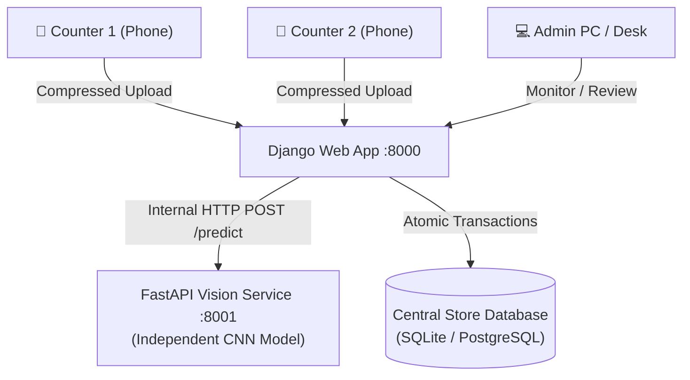

# 🛒 Grocery Billing Application (Snap & Bill)

A modern, mobile-friendly **in-store grocery billing and Point-of-Sale (POS) system** where cashiers simply snap photos of grocery items on their smartphones instead of scanning barcodes.

An independent, decoupled **CNN Vision Model Service** automatically identifies products from images, generates an itemized bill with remarks (e.g., expiry alerts), and allows cashiers to review, edit, and settle payments via **UPI QR Code**, **Cash**, or **Card**.

---

## 🌟 Key Highlights

- **⚡ Fast Phone Uploads (Client-Side Compression):** In-browser canvas compression scales 4K camera photos down to 1600px at 0.82 JPEG quality before upload. Reduces an 8 MB photo to ~250 KB in under 100ms, slashing upload times from 8s to under 0.3s.
- **🧠 Decoupled Vision Model Service:** The CNN vision model runs in an independent **FastAPI service (Port 8001)**. You can train, update, and improve your neural network weights in Python independently without restarting or modifying the main web app.
- **🏪 Single Store, Central Synchronized Ledger:** Designed for a single physical store with multiple billing counters:
  - Multiple cashiers can scan groceries concurrently from different phones without database lock collisions.
  - The central dashboard aggregates live shop revenue (Today's Sales, Month-to-date, Total Revenue, Active Cashiers).
  - Synchronized pending review queue with cashier attribution.
- **📱 Dynamic UPI QR Payments & Cash Calculator:**
  - Generates standard NPCI **UPI QR codes** offline for the exact bill total (compatible with Google Pay, PhonePe, Paytm, BHIM).
  - Includes a live **Cash Tender Calculator** (*Cash Received* $\rightarrow$ *Change to Return*).
- **💬 Digital Receipt Distribution:**
  - One-click **WhatsApp delivery** to send formatted receipts directly to the customer's phone.
  - Copyable digital receipt link and native mobile share sheet (`navigator.share`).
  - **58mm and 80mm thermal printer format** (`@media print` optimized).
- **🔒 Invite-Only Staff Authentication:** Gated registration via one-time admin invite tokens.
- **📜 Dedicated Past Bills Archive:** Search and filter historical bills by cashier, status, date, or product name.

---

## 🏛️ System Architecture



---

## 🚀 Quick Start (Windows)

### Option 1: 1-Click Launch (Recommended)
Double-click:
```
run.bat
```
*(Or in PowerShell: `.\run.ps1`)*

This script automatically:
1. Applies pending database migrations.
2. Starts the **Vision Model Service** on port `8001`.
3. Detects your local Wi-Fi IP address.
4. Starts the **Django Web App** on `0.0.0.0:8000`.

---

### Option 2: Manual Terminal Setup

1. **Clone the repository:**
   ```bash
   git clone https://github.com/pes1ug23am221/billingApplication.git
   cd billingApplication
   ```

2. **Set up Python Virtual Environment:**
   ```bash
   python -m venv .venv
   .\.venv\Scripts\pip install -r requirements.txt
   ```

3. **Configure Environment:**
   Copy `.env.example` to `.env`:
   ```ini
   SECRET_KEY=your-secret-key
   DEBUG=True
   DB_ENGINE=sqlite
   ALLOWED_HOSTS=*
   MODEL_SERVICE_URL=http://127.0.0.1:8001
   STORE_NAME=Central Grocery Store
   STORE_UPI_ID=grocerystore@upi
   ```

4. **Run Migrations & Initialize Admin:**
   ```bash
   .\.venv\Scripts\python.exe manage.py migrate
   .\.venv\Scripts\python.exe manage.py init_admin
   ```

5. **Start Both Services:**
   - **Terminal 1 (Vision Model Service):**
     ```bash
     .\.venv\Scripts\uvicorn.exe model_service.main:app --host 0.0.0.0 --port 8001
     ```
   - **Terminal 2 (Django Web App):**
     ```bash
     .\.venv\Scripts\python.exe manage.py runserver 0.0.0.0:8000
     ```

---

### Option 3: Docker Compose
If you have Docker installed:
```bash
docker compose up --build
```

---

## 📱 Connecting Cashier Phones over Wi-Fi

1. Connect your smartphone to the **same Wi-Fi network** as the host PC.
2. Check your PC's local IP address (e.g., `192.168.1.2`, displayed when starting `run.bat`).
3. Open the browser on your phone:
   ```
   http://192.168.1.2:8000
   ```
4. Log in with the default admin or an invited cashier account.
5. Tap **"+ New Bill"** $\rightarrow$ tap the photo input to open your phone camera.

---

## 🔑 Default Credentials

- **Username:** `admin`
- **Password:** `admin123`

---

## 🧠 Integrating Your Real CNN Model

The vision service in [`model_service/main.py`](model_service/main.py) is intentionally decoupled. To plug in your real CNN weights:

1. Open `model_service/main.py`.
2. Load your model weights at startup:
   ```python
   import torch

   model = torch.load("grocery_cnn_weights.pt")
   model.eval()
   ```
3. In the `@app.post("/predict")` endpoint, replace the stub lines with inference logic:
   ```python
   @app.post("/predict", response_model=PredictResponse)
   async def predict(req: PredictRequest):
       # req.image_paths contains paths to the uploaded photos
       detected_items = []
       for img_path in req.image_paths:
           # Run your model inference here
           ...
       return PredictResponse(
           remarks="Check dairy products",
           items=[
               ItemResult(product_name="Whole Milk 1L", quantity=2.0, unit_price=55.0, remark="check expiry"),
               ...
           ]
       )
   ```
4. The Django web app, database models, templates, and mobile interfaces remain **100% unchanged**.

---

## 🧪 Automated Testing

Run the full Django test suite:
```bash
.\.venv\Scripts\python.exe manage.py test
```
All **8 unit tests** verify:
- Staff invite token generation and token-gated registration
- Unit price $\times$ quantity calculation
- Single-store synchronized dashboard metrics
- Cashier filtering in the past bills archive
- Offline UPI QR code generator
- Bill settlement with Cash, UPI, and Card
- Customer WhatsApp receipt generation
- Staff and cashier delete permissions

---

## 🛠️ Tech Stack

- **Backend:** Python 3.12, Django 5.0, Gunicorn, WhiteNoise
- **Vision Microservice:** FastAPI, Uvicorn, Pillow, QRCode
- **Database:** SQLite (default for zero-friction setup) / PostgreSQL 15 (Docker supported)
- **Frontend:** Server-Side Rendered HTML5, Mobile-First CSS, Minimal Vanilla JavaScript (Canvas photo compression & live tender calculation)

---

## 📄 License
This project is licensed under the MIT License.
